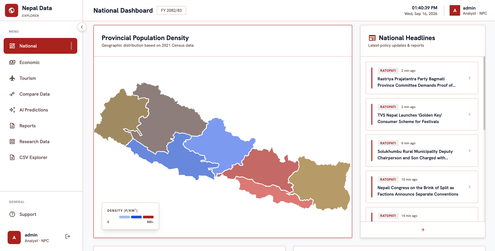
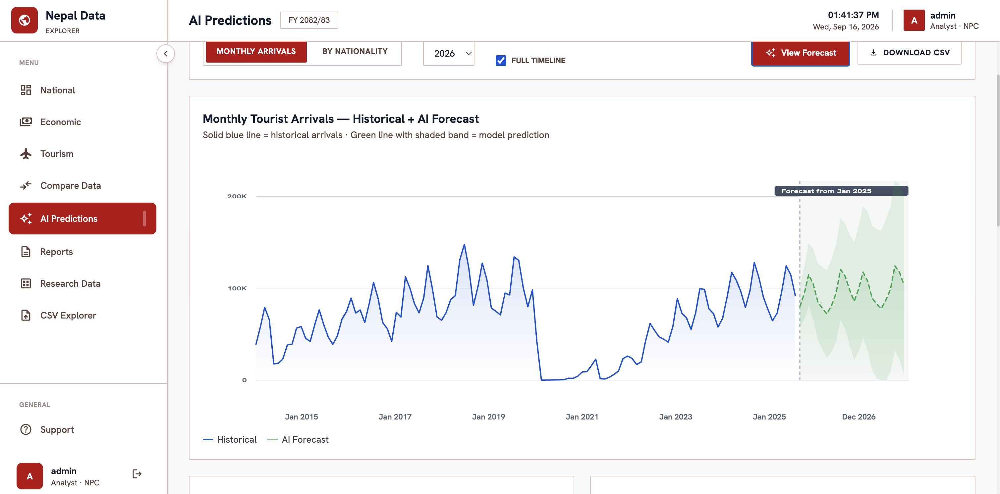

# Nepal Data Explorer

A national dashboard for Nepal's economy, tourism and demographics, built with Django + React.





## Tech Stack

- **Backend:** Django, Django REST Framework, SimpleJWT, PostgreSQL (Neon), Hugging Face toxicity moderation
- **Frontend:** React 18, Vite, TailwindCSS, Recharts, React Router, Leaflet

## Features

- National / provincial dashboards for economic, tourism and demographic data
- AI-powered forecasts with ARIMA/SARIMA models and confidence intervals
- Compare provinces side-by-side, browse datasets, and export reports
- Google + GitHub OAuth login, JWT auth, email verification, and profanity/toxicity moderation on support messages
- Live RSS news aggregation

## Setup

### 1. Backend

```bash
cd backend
python3 -m venv venv
source venv/bin/activate
pip install -r requirements.txt
```

Set your environment variables in `backend/.env` (`SECRET_KEY`, `DATABASE_URL`, `FRONTEND_URL`, email SMTP settings, OAuth keys).

Download the toxicity model weights (required for support-message moderation):

```bash
python scripts/download_toxicity_model.py
```

Run migrations, checks and tests:

```bash
python manage.py migrate
python manage.py check
python manage.py test
```

### 2. Frontend

```bash
cd frontend
npm install
npm run dev
```

The app runs at `http://localhost:5173` and expects the API at `http://localhost:8000`.
